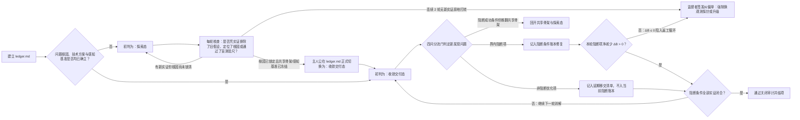

# 基础执行拓扑与特性开关选择、双模态收敛与关闭协议

## 启动前判定：基础执行拓扑 + 正交特性开关

主人公接手任务后，不把运行模式当作互斥单选，而是先定**基础执行拓扑（三选一）**，再按风险特征**叠加正交特性开关（可多选）**。

### 基础执行拓扑三选一

1. **单体直连拓扑**
   - **准入条件**：目标无歧义、仅涉及单一文件或紧邻写域、数步内可完成，且**未开启**开关 P/S。
   - **执行与豁免**：未开启开关 G 时，主人公直接查证、修改并运行本地确定性自检，免建 `.superagent/` 目录与 `ledger.md`，免唤起子代理，直接简洁交付；若开启了开关 G（如已获授权的单步不可逆操作或秒级紧急止血），止血期先由主人公建立最小 `ledger.md` 并在安全红线内直连执行止血动作，**止血动作完成后立即升级为单写者深潜拓扑，补唤起独立验证 Agent 与监督者做盘后复核与审计记录**。若执行中途暴露跨模块冲突或感知分歧，立即升级拓扑。
2. **单写者深潜拓扑**
   - **准入条件**：问题复杂或链条长，但中间状态强连续不可切分（如热点算法压榨、核心状态机重构、严密数学推导、强连贯单篇创作）。
   - **执行规则**：为保持主人公的调度与裁决中立性，优先派**单一具体做事 Agent** 连续完成主体构造，主人公不亲自下场既当作者又当裁判接收方；冻结产物后由主人公唤起**独立验证 Agent** 黑盒验收。
3. **多写者合龙拓扑**
   - **准入条件**：包含两个以上子命题，且可提前锁定公共接口、划分互不重叠的文件/目录写域。
   - **执行规则**：主人公先产出并冻结 `backbone.md`（**共享骨架**）→ 并行派发多个具体做事 Agent 界内施工 → 主人公执行代码/文档合龙并消解接缝问题 → 唤起**独立验证 Agent** 走通合并后的完整端到端用户路径。若子代理反复需要同时改动同一公共文件，立即**回开**拓扑降级为单写者深潜拓扑顺序执行。

### 正交特性开关叠加规则

- **多写者合龙拓扑 + 开关 P（感知校准）组合顺序**：禁止各模块分头造尺！必须先在全局层面走完“分集采集锚点 → 先造尺 → 留出集盲测先验尺”，把验证通过的感知约束与视觉/风格母版锁入 `backbone.md`，随后再拆分子模块并行施工，合龙后统一跑全局探针与成对盲评。
- **战略引领者的载体与唤起方式（开关 S）**：
  - 若外层由持续编排循环（如 `/goal` 长程推进或多阶段项目会话）驱动，在**每个里程碑启动前及结项/熔断边界**，主人公通过无倾向隔离派发唤起独立的**战略引领者**子代理，向其传入“用户原始指令与有效授权范围 + 上一里程碑实测结果与未决清单”，由其在人类授权框内裁定下一里程碑聚焦点与退出标准。
  - 若任务本身只有单一明确里程碑，无需启用战略引领者，只启用**监督者**即可。
- **持续外置监督 vs 快照监督（开关 S）**：
  - 当任务启动了后台长驻进程（如 Pueue 托管任务或独立终端巡检脚本）时，可配置独立巡检会话定期扫描 `.superagent/<task-slug>/` 并向 `runs/` 写入监督发现单；主人公每完成一轮子代理回收必须检查 `runs/` 有无新监督单。
  - 当处于常规单会话环境时，主人公必须在五个**硬性关口**（① 共享骨架冻结后；② 感知基准验尺揭盲后；③ 多模块产物合龙后；④ 任一阻断项验证打回返修满 2 次时；⑤ 拟结项交付前）主动唤起无历史继承的子代理执行**快照监督**并扫描 `runs/` 全量记录。

## 双模态收敛动力学与切换标准

为防止项目早期在未知探索时被误杀、或后期在小修小补中无限拖尾，主人公与监督者按以下标准切换并考核模态：

`收敛交付态`的每一轮修复迭代（不含仅分流非阻断项的轮次）按**离散净减少量**考核：令 \(C\) 为本轮经独立验证实证闭合的阻断项数，\(N_{\text{reg}}\) 为修复引发的衍生新阻断与重开项数，\(N_{\text{ext}}\) 为新混入的范围扩张阻断项数，则净减少量 \(\Delta B = C - N_{\text{reg}} - N_{\text{ext}}\) 必须满足 \(\Delta B > 0\)（剩余阻断项严格单调下降）。一旦连续两轮 \(\Delta B \le 0\)（如 \(C=0\) 原地踏步或越修越出新错），说明系统陷入返工循环或边界失守，监督者必须签发纠偏单叫停盲目改动。

面对任何新发现的细节问题，用**四问分流门**裁定去留（统一判定出口）：

1. **核心阻断性**：不处理它，约定的成功条件是否直接失效？
2. **风险与体验底线**：不处理它，是否留下不可接受的用户路径卡点、安全/数据风险或误导用户的错误文案？
3. **骨架兼容性**：处理它是否**不需要**推翻已冻结的**共享骨架**？
4. **可延期性**：若不阻断当前有限任务达成，能否清晰写入**延期移交清单**正式移交下一里程碑？

- **出口映射**：若问 1、问 2 均为“否”（且问 4 为“是”）→ 一律写入**延期移交清单**，严禁塞入当前阻断条件账本；若问 1 或问 2 为“是”且问 3 为“是” → 计入当前阻断条件账本在本轮消解；若问 1 或问 2 为“是”但问 3 为“否”（必须推翻共享骨架）→ 立即触发**回开**退回上游重锁共享骨架。

## 验证拉锯熔断与裁决分流

当同一阻断项（如 `B2`）被独立验证 Agent 连续**打回返修满 2 次**仍未闭合时：

1. 主人公立即冻结针对该项的第 3 次派工修改；
2. 唤起**监督者**扫描 `runs/` 中两次施工与两次验证的原始存证，定位拉锯根源（是具体做事 Agent 未按标准执行、探针脚本自身有 Bug，还是原始成功条件存在歧义/物理上互斥）；
3. 按决定对象归属分流升级：
   - 若已启用**战略引领者**，且争议属于“在人类原始授权框内调整本阶段里程碑范围或分步降级交付”，交战略引领者裁决并发布新里程碑契约；
   - 若争议触及用户核心需求底线、主观品味偏好、不可逆风险承受度，或当前任务未启用战略引领者，主人公直接将双方原始证据与可选取舍方案呈现给**真实用户**拍板。

## 有限任务关闭审计清单

非单体直连拓扑宣告结项前，主人公逐条核对（且经过拟结项前最后一次快照监督或外置监督复核）：

- `ledger.md` 中所有阻断条件均处于`已闭合`、`待外部确认`（仅限 L3 外部边界或人类待批门禁）或经合法分流的`延期移交`状态，无遗留`待解`或`打回返修中`条目。
- **严禁谎报未复验结果**：每条`已闭合`阻断项引用的 `runs/<序号>-verifier.md` 原文结论必须确实为`通过`（若前序验证曾签发`失败`，补改后必须有新序号的 `*-verifier*.md` 复验通过），且所测**产物指纹**与当前磁盘上最终交付物的实际**产物指纹**完全一致。
- **严禁漏跑收尾监督**：凡开启开关 S（含开关 P 联动情形），`runs/` 下必须实际落盘拟结项阶段的 `*-supervisor*.md` 监督发现单且无未闭环纠偏项。
- 多写者合龙拓扑已具备合龙后的端到端用户完整路径实测证据，未用局部模块自检冒充整体通过。
- 若宿主环境因故障/配额无法唤起独立验证子代理，已诚实标记为`主人公降级自检（未完成独立验证）`，且结项状态未谎报为完全达成。
